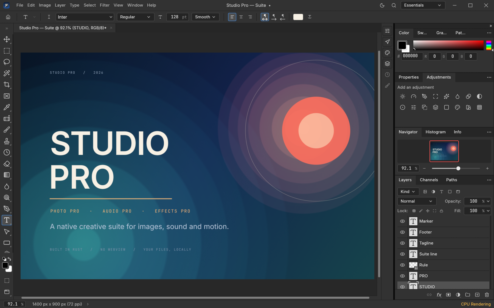

# Studio Pro

A native creative suite for images, sound and motion: **Photo Pro**, **Audio Pro** and
**Effects Pro**. Built in Rust, with a real PSD pipeline, native audio playback and a
GPU compositor. No Electron or webview on the desktop.

This repository is the public documentation and release home. It does not host the
Studio Pro source code.

[Releases](https://github.com/ThatAerospaceandTechGuy/studio-pro/releases) ·
[Report an issue](https://github.com/ThatAerospaceandTechGuy/studio-pro/issues) ·
[Release policy](RELEASES.md) · [Changelog](CHANGELOG.md)

| App | Role | Reads / writes |
| --- | --- | --- |
| **Photo Pro** | Layer-based image editor | `.pcraft`, PSD/PSB, layered TIFF |
| **Audio Pro** | Waveform sound editor | WAV, MP3, FLAC, OGG |
| **Effects Pro** | Motion-graphics and visual-effects editor | `.fxproj` |



## Download

There are **no public installers yet**. This repository is the public release home and
issue tracker; the application source is maintained privately during early alpha. Watch
the repository for the first build.

When the first suite build is ready, this repository will publish:

- platform packages for Photo Pro, Audio Pro and Effects Pro on Windows, macOS, Linux and FreeBSD;
- Effects Pro announcements when that build is ready;
- a checksum file for every release;
- release notes and known limitations;
- the licence, notice and attribution files that ship with the binaries.

Release tags, asset naming, checksum and pre-release rules are in
[RELEASES.md](RELEASES.md). Public release packages will be the supported way to use
Studio Pro.

## Why the file formats are not the hard part

PSD/PSB is a published format, as are TIFF, OpenRaster, XCF, KRA and SVG. Parsing the
containers is the measurable part. The hard part is behaviour: blend modes, clipping
masks, layer styles, adjustment layers, smart objects, text layout, ICC transforms and
holding 8-, 16- and 32-bit data together through an edit.

That work is tested against real files and a round-trip corpus, not a menu checklist.
Unknown PSD blocks are preserved verbatim. `.pcraft` fails to compile when a document
field is added without a serializer, so a save cannot silently drop part of a document.

## One suite, three surfaces

Photo Pro and Audio Pro share one Cargo workspace and one UI shell. Effects Pro is a
separate app in a nested workspace with its own dependency pins; it ships as its own
application.

```
crates/psd          standalone PSD/PSB parser and writer
crates/codecs       standalone codec crates
crates/cms          ICC colour management
crates/doc          document model
crates/compose      CPU compositor (the reference)
crates/gpu          wgpu compositor
crates/engine       session and command registry
crates/ui-egui      native egui/eframe shell

apps/studiopro      Photo Pro
apps/audiopro       Audio Pro
apps/studiopro-web  Photo Pro WebAssembly build
effectspro/         Effects Pro: engine, apps, web build and packaging
```

Rules that keep this honest:

1. **Every Photo Pro action is a command.** The UI, `studiopro-cli`, the JSON control
   channel and the MCP server all dispatch the same engine.
2. **Bit depth and colour model are runtime data.** Public pixel paths are not `u8`-only,
   and no colour conversion assumes sRGB; conversions go through the ICC transform.
3. **Input is hostile.** Malformed files, bad command parameters, a corrupt settings file
   or a full disk return an error. They do not panic or take the document with them.
4. **Unknown content is preserved.** PSD blocks the editor does not model are kept
   verbatim, and `.pcraft` has no silent field loss.

## Formats, colour and automation

| Area | Support |
| --- | --- |
| **Images** | PSD/PSB, layered TIFF, `.pcraft`, PDN, ORA, XCF, KRA, Affinity (read-only), SVG, PNG, JPEG, TIFF, WebP, GIF, BMP, TGA, ICO, QOI, PNM, OpenEXR, Radiance HDR and FITS. Desktop code supports HEIC; AVIF export is an optional build feature. |
| **Audio** | WAV, MP3, FLAC and OGG; 16-bit WAV export. |
| **Colour** | RGB, Grayscale, CMYK and Lab at 8, 16 and 32 bits per channel; ICC management, Assign/Convert to Profile, soft proofing and gamut warning. |
| **Automation** | Every Photo Pro action is a command, driven from the UI, `studiopro-cli`, a JSON control channel or an MCP server. |

## Status

Early alpha. There are no public installers yet; the source is maintained privately.

| Area | State |
| --- | --- |
| **Photo Pro** | Layer-based editor with PSD/PSB round-trip across a real corpus, masks, clipping masks, layer styles, adjustment layers, smart objects and smart filters. |
| **Audio Pro** | Waveform editing with playback, cut/copy/paste, trim, undo/redo, normalize, amplify, fades, reverse and 16-bit WAV export. |
| **Effects Pro** | Layer-based compositor with keyframes, expressions, 3D cameras and lights, effects and a render queue. |
| **Web** | Photo Pro static WebAssembly build; Effects Pro web build in development. |
| **Platforms** | Windows, macOS, Linux and FreeBSD. |
| **Stability** | Early alpha — keep backups of important documents. |

## Licence

Studio Pro is licensed under the **MIT License** or the **Apache License, Version 2.0**,
at your option.

It is inspired by ArtCraft and retains the upstream copyright and licence notices. The
Studio Pro, Photo Pro, Audio Pro and Effects Pro names, application icons and suite
artwork are original to this project and are covered by the same terms. Studio Pro is
not affiliated with or endorsed by ArtCraft or its authors.

The licence texts and third-party notices are included in this repository:
[MIT](licenses/MIT.txt), [Apache-2.0](licenses/Apache-2.0.txt), [NOTICE](NOTICE) and
[ATTRIBUTION.md](ATTRIBUTION.md). See [LICENSES.md](LICENSES.md) for the scope. Every
binary release will bundle the applicable notices.

## Security and support

- **Security reports:** follow [SECURITY.md](SECURITY.md). Do not post exploit details,
  credentials or malicious image files in a public issue.
- **Product and release support:** open an issue after reading [SUPPORT.md](SUPPORT.md).
- **Development updates:** watch the [releases page](https://github.com/ThatAerospaceandTechGuy/studio-pro/releases)
  for public build announcements.

## Repository scope

This repository is the public release home and issue tracker for the Studio Pro suite.
It contains documentation only: no application source, private build scripts or public
binaries. All three apps are developed together in one Studio Pro source repository.
